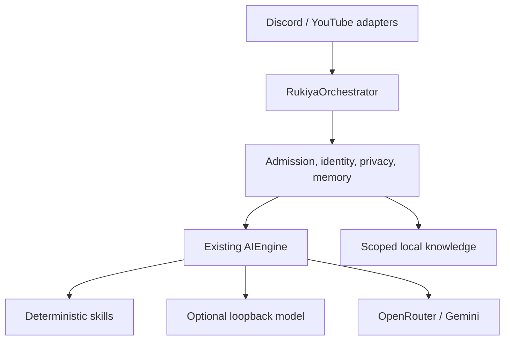

# Rukiya Brain: hybrid intelligence and private memory

Implementation date: 9 November 2026. Repository: `rukia3287-jpg/rukiya`. Baseline: `a13998f7e4f6e18ebe01d0174f6cdc1415de63de`. This is an extension of Rukiya's existing architecture. Lxeus code, providers, database and repository were not imported or modified.

## Assessment and architecture

Rukiya already had an orchestrator, stable platform identities, scoped Discord memory, public-stream context, deterministic eligibility/planning, separate OpenRouter/Gemini capabilities, daily budgets, search caches, safety/critic/repair stages, SQLite recovery, operator-only YouTube controls, and a substantial offline suite. The baseline suite passed **271 tests** before edits.

The runtime is Python (CI: 3.11; `render.yaml`: 3.11.5), discord.py, aiohttp/httpx, SQLite, Google API/OAuth libraries and google-genai. Render's existing web-service configuration starts `main.py` and exposes `/health`. Its source declares the free plan and no persistent disk. That file does not prove durable filesystem storage or resources for inference. No dependencies or deployment framework were replaced.

Important dependencies, verified from source:

| Layer | Main dependencies |
| --- | --- |
| `main.py` | Config, MemoryService, IdentityService, YouTubeService, AIService, AIEngine, RukiyaOrchestrator, ChatMonitor, cogs |
| Discord cogs | Orchestrator and existing operator-access/UI helpers; native commands retain their permissions |
| ChatMonitor | YouTube service, bounded event dedupe, stream lifecycle, orchestrator callback |
| Orchestrator | Identity, safety, memory worker, decision service, token buckets, AIEngine or guarded legacy AIService |
| AIEngine | Planner, router, context compiler, registry, executor, budgets, capability health, evidence, critic and repair |
| Memory | Existing SQLite tables and fallback/recovery state; new Brain tables use the same file |
| Providers | OpenRouter HTTP, Gemini SDK, optional loopback text adapter |

The actual source already provided many requested Brain capabilities. Replacing these with another orchestrator or vector database would introduce competing state and regressions. This upgrade adds missing capabilities at the existing boundaries:



Observed gaps before implementation:

- Useful AI entry points still required external generation, even for arithmetic or retrieving a known fact.
- Automatic profile-fact extraction and persisted recent chat were enabled by pipeline behavior, without self-service consent controls.
- Search caches and in-flight tasks used normalized query keys without viewer/conversation ownership. Personal research responses could be reused across users; punctuation normalization could also merge distinct queries.
- Semaphores bounded provider work but not the full incoming request queue, total lifecycle, or same-conversation concurrency.
- Memory already used cancellation-safe worker execution; that implementation was preserved and extended for privacy writes/deletion recovery.
- OpenRouter created and closed an HTTP client for every generation. Existing provider budgets, transient backoff and fail-fast 429 handling were already useful and retained.
- Existing persona and conversation tests were strong. The goal was better routing/context around that persona, not a new scripted character.

## How the Brain works

The orchestrator admits a bounded number of active requests before identity/SQLite work, applies a total deadline, resolves trusted adapter identity, reads privacy policy, retrieves bounded context, runs the existing decision/rate rules, and chooses a local control/knowledge operation or the AIEngine. Its active request records cannot expire while held; there is no unbounded admission waiting queue.

AIEngine handles exact local calculations, identifiers and approved key lookup without inference. Arithmetic is a small AST interpreter with expression/node/exponent/value caps; it never evaluates Python code. A 256-entry, five-minute cache stores deterministic arithmetic only. Repeating a valid local result does not trigger the conversation anti-repetition fallback. Negative numeric results bypass markdown-hyphen stripping so `2-7` remains `-5`.

For generated conversation, the existing planner selects freshness and complexity without an LLM planning call. Optional local text inference is preferred for suitable non-search requests. Complex requests can prefer external inference when allowed; if remote models are unavailable, local text inference remains a possible non-search route. Local failure allows a bounded external fallback only when policy permits it. Existing OpenRouter/Gemini backup, search verification, budgets, critic and repair remain in use. Repair of a local reply stays on the local provider when necessary; it cannot silently send opted-out context to an external model.

User style preferences guide the existing character brief: adaptive, casual, friendly, playful, sarcastic, serious, technical, helpful or concise. Serious/crisis intent overrides playful/sarcastic preferences. The 250-character chat ceiling and existing one/two-sentence contracts remain suited to livestream delivery. Hindi, Hinglish, Roman Telugu and script behavior continue through the existing language/safety system. No canned conversational reply library was added. Model quality still determines free-form conversation, reasoning and language quality.

Existing Discord commands and YouTube send controls remain deterministic. This bot has no general AI moderation/tool executor to replace: no new model-authorized platform mutations were introduced. `/say`, stream start/stop, posting an `/ask` result to YouTube, welcomes and related controls keep their existing owner/operator checks. No new proactive feature was enabled and existing idle-chat settings were preserved.

## Memory and privacy

New defaults: temporary bounded conversation context, **persistent recent-chat history off**, and **automatic fact extraction off**. A user can explicitly approve facts or opt into extraction/history in their current identity scope. Older automatic facts remain in storage until retention/reset but are excluded from ordinary generation unless that user opts in; `user_approved` records can be used without automatic extraction. Old persisted chat is not reloaded for opted-out users.

Discord identity continues to include guild or DM scope; conversation history additionally includes the channel. YouTube keeps its stable channel-ID profile with a per-stream conversation scope. Display names never grant access to another user's memories. Explicit account linking retains the existing semantics and does not merge memories. Private personal fact retrieval is always bound to the resolved viewer; ordinary group history remains public-channel/stream background with explicit identity labels.

| Discord command | Access and behavior |
| --- | --- |
| `/my_memory` | Private inspection of your scoped preferences and approved facts; long results use an ephemeral file |
| `/remember key value` | Explicitly approve/replace your own fact; 64-character key and 1,000-character value caps |
| `/forget_memory key` | Delete one fact and clear your conversation context in this scope |
| `/clear_my_memory` | Erase your facts, history, stream facts and feedback in this scope; retain privacy choices |
| `/memory_preferences history automatic_facts external_ai` | Choose persisted history, extraction and external processing; choices are not taken from model output |
| `/chat_style style` | Save one supported response-style preference |
| `/cancel_ai` | Cancel your active requests in this guild/DM scope and clear your cached search work |
| `/ai_feedback helpful` | Explicit metadata-only usefulness signal, no conversation text |
| `/knowledge_add title text` | Bot owner/configured operator only; publish curated public knowledge into the current server/DM scope |

The self-service commands accept no target-user ID. The existing operator `/memory_lookup` and confirmed `/memory_reset` tools remain available under their original permissions. A server administrator alone still does not gain global operator access.

YouTube viewers can use exact, self-owned text controls without requiring an LLM:

```text
rukiya remember favorite_game=Minecraft
rukiya forget favorite_game
rukiya privacy history=off automatic=off external=off
rukiya clear my memory
```

These commands act only on the stable identity supplied by the platform adapter. They acknowledge the operation without echoing stored private values. They are strict structured operations, not broad keyword-based interpretation. Memory commands typed in a public chat are themselves public; Discord slash responses are ephemeral.

Local retrieval examples:

```text
rukiya calculate (25 + 5) * 4
memory: favorite_game
knowledge: server rules
```

`memory:` retrieves only the requesting user's available approved context. `knowledge:` returns a marked stored excerpt from operator-curated knowledge; it is not a synthesized or freshly verified answer. Knowledge scope comes from adapter metadata, never prompt text. SQLite FTS5 ranks scoped matches when available, with a bounded lexical fallback. No embeddings or new database are required. There is no automatic ingestion of private user answers into this knowledge table.

Defaults and bounds:

- RAM history: at most 256 conversation scopes, at most the existing small turn bound per scope, 800 characters per stored turn, 15-minute relevance TTL.
- Approved facts: existing 30-record per-identity bound plus 90-day retention. Fact correction replaces the same normalized key.
- Curated knowledge: at most 1,000 rows globally, 4,000-character bodies, 30-day expiry.
- Feedback: at most 1,000 metadata-only records, cleaned at 30 days on writes.
- Preference cache: bounded normal read cache, with up to 1,000 pending preference changes during storage failure; excess writes are explicitly refused rather than falsely acknowledged.

Retention is checked during reads and cleaned opportunistically, not by a continuous deletion scheduler. Profile identity/counter metadata and existing fallback recovery structures retain their established behavior and can scale with viewers. SQLite files, WAL journals and backups need normal operator storage controls; logical deletion is not secure media wiping or remote-provider deletion.

Preference-read failures default to no external egress unless the policy is already known in memory. During an outage, deletion and privacy choices apply in process immediately and queue for recovery. Recovery replays deletions before later writes, so erased records are not resurrected. Commands report whether persistence succeeded. Pending outage changes are process-local and cannot survive a process restart before recovery.

Clearing memory cancels the user's active pipeline work and search tasks before deleting state. Already dispatched model requests or already transmitted Discord/YouTube messages cannot be recalled. No hidden claim of remote deletion is made.

## Caching, safety and lifecycle

Positive/negative search cache entries and in-flight search tasks are partitioned by stable owner and conversation. Ownership is hashed before query normalization, retaining case-sensitive platform identity boundaries. A separate query hash preserves meaningful punctuation such as `C++` versus `C`. This deliberately sacrifices cross-viewer cache reuse to preserve privacy. Same-owner/same-conversation queries can still reuse bounded entries. Clearing one owner removes only that owner's cache partitions and pending search work.

Shared in-flight tasks are shielded from one waiter's cancellation, bounded at 128 active keys, and cleaned after completion even if all waiters leave. Explicit shutdown or an owner's clear operation cancels relevant tasks and awaits completion. Whole-request deadlines include waiting for provider capacity. The existing SQLite worker keeps its lock until a cancelled transaction finishes, preserving erasure ordering.

Optional inference uses asynchronous loopback HTTP with one local inference at a time, lazy session creation, bounded output bytes and no redirects/proxy forwarding. Non-loopback URLs and URL credentials are rejected as local-runtime configuration. Tool calls from a local model are rejected; it has no action authority.

OpenRouter now reuses its owned HTTP client and closes it on shutdown. Existing injected clients remain caller-owned. Gemini's owned synchronous and asynchronous SDK clients are closed explicitly. Global external-off mode also applies to legacy generation entry points, while per-user privacy is enforced through the production orchestrator. Existing credential masking, prompt/output safeguards and platform permission checks remain in use. Stored facts/current input are encoded as untrusted data and optional prompt blocks are dropped as a unit to fit the context bound.

The operator `/bot_status` panel includes bounded Brain latency/admission metrics and provider-operation counts. The engine retains bounded recent outcome samples, deterministic cache counters, and existing provider/budget telemetry. Counters describe admitted provider operations, not a currency ledger or necessarily every HTTP retry inside an adapter. Feedback is available for evaluation; it does not train weights, modify production code or automatically rewrite policy.

## Configuration and resource requirements

See the credential-free [.env.example](.env.example). No dependency was added to `requirements.txt`, and `render.yaml` was left unchanged. Restart the bot to load the new code/configuration.

| Variable | Default | Meaning |
| --- | --- | --- |
| `EXTERNAL_AI_ENABLED` | `true` | Global external generation/search switch; scoped user policy can restrict it further |
| `LOCAL_AI_ENABLED` | `false` | Opt into an operator-provided local text runtime |
| `LOCAL_AI_URL` | `http://127.0.0.1:11434/v1` | Loopback OpenAI-compatible base URL; Ollama/llama.cpp style endpoint |
| `LOCAL_AI_MODEL` | empty | Explicit model identifier; no automatic download or model selection |
| `LOCAL_AI_TIMEOUT` | `15` | Local inference timeout, 1–60 seconds |
| `BRAIN_TIMEOUT` | `45` | Total request deadline, 1–180 seconds; bounded SQLite cleanup may finish after cancellation |
| `BRAIN_MAX_ACTIVE` | `8` | Active full-pipeline request cap, 1–64 |
| `BRAIN_GUILD_ACTIVE` | `3` | Active server/stream bucket cap, 1–16 |
| `BRAIN_USER_ACTIVE` | `2` | Active owner cap within that platform/guild, 1–4; same conversation admits one request |
| `BRAIN_PROMPT_CHARS` | `4000` | Input size cap, 100–8,000 |
| `BRAIN_CONTEXT_CHARS` | `24000` | Content-size budget, 12,000–48,000; optional blocks are dropped without truncating policy |
| `BRAIN_SESSION_TTL` | `900` | Recent-history TTL in seconds, 60–86,400 |
| `BRAIN_SESSION_COUNT` | `256` | RAM conversation-scope capacity, 1–5,000 |
| `MEMORY_AUTO_EXTRACT` | `false` | Default automatic-fact choice; viewers can set their own preference |
| `MEMORY_HISTORY_ENABLED` | `false` | Default persisted-history choice; viewers can set their own preference |
| `MEMORY_RETENTION_DAYS` | `90` | Fact-retention maximum age, 1–365 days |

Existing external model identifiers, keys, provider budgets, search settings, generation concurrency, reasoning settings and YouTube OAuth names remain unchanged. Numeric environment values are independently parsed; nonfinite values are refused and new Brain settings are clamped. Existing generation/search budgets reset at the UTC day boundary and are process-local; local/deterministic paths do not consume the global external-operation counters. A model-served local request still uses the existing logical per-user request budget. No spending, training or infrastructure was provisioned.

The checked-in deployment targets a small Render service. Local inference is off by default and no GPU, model RAM, or persistent disk is assumed. Keep it off when that machine cannot host inference. If an operator supplies a loopback runtime on suitable hardware, choose a model only after measuring its weight/context memory, CPU/GPU use, disk and latency on that deployment. A protocol-compatible simulated runtime was tested; no real model was downloaded or benchmarked. The loopback adapter follows the documented text chat-completion interfaces of [Ollama](https://github.com/ollama/ollama/blob/main/docs/api/openai-compatibility.mdx) and [llama.cpp](https://github.com/ggml-org/llama.cpp/blob/master/tools/server/README.md).

A writable persistent `DB_PATH` is necessary for memories/preferences/knowledge to survive redeploys. Existing SQLite fallback handles a temporary unavailable database; it cannot provide durable storage without a persistent filesystem. Admission, budgets, pending writes and RAM caches are designed for the repository's single-process deployment, not a cluster-wide distributed control plane.

## Validation and measurements

The baseline passed 271 tests. The updated suite passes **304 tests**, including 33 new Brain regressions and the updated opt-in extraction fixture. The existing fixture now explicitly enables automatic facts before asserting extraction; a new test separately verifies the default privacy behavior.

Checks executed:

```text
.venv/bin/python -m unittest discover -s tests -p 'test_*.py'
.venv/bin/python -m compileall -q services cogs tests scripts main.py
.venv/bin/python -m scripts.benchmark_brain
git diff --check
```

Validation covers existing Discord/YouTube trigger, serious-message, language, safety, operator UI, budget, memory recovery and shutdown behavior, plus local routing, approved memories, privacy opt-out, old-history exclusion, isolation, FTS/lexical retrieval, outage deletion replay, concurrency/cancellation, timeouts, owned commands, query identity/punctuation, local failure, numeric correctness, lazy pooling, and real loopback HTTP with chunked, redirected, malformed, tool-producing and oversized responses. The existing network-stubbed bot-wiring tests load all extensions and serialize commands. A separate no-network smoke check loaded all eight cogs with zero failures, registered 28 slash-command roots, and shut down with zero extensions and zero active Brain requests remaining. No real Discord login, YouTube polling/posting, OAuth refresh or external model request was performed.

Measured in this Linux workspace on Python 3.12.14 (CI still targets 3.11), sequential offline samples:

| Metric | Baseline median / p95 ms | Updated median / p95 ms | Samples |
| --- | --- | --- | --- |
| Deterministic planning | 0.0622 / 0.1604 | 0.0620 / 0.1266 | 1,000 |
| Scoped relevant-memory lookup | 0.3870 / 0.6092 | 0.3463 / 0.5327 | 100 |
| Scoped retrieval over 100 curated documents | unmeasured | 5.9934 / 7.3554 | 50 |
| Full deterministic pipeline, including identity/SQLite/safety | no local path | 3.2151 / 4.7046 | 100 |

The deterministic run made zero provider operations, had zero errors and achieved a 99% repeated-arithmetic cache hit rate. FTS5 was available. Peak process RSS for that synthetic benchmark was 32,528 KiB. Real model latency and first-token timing are unmeasured (`null` in the [benchmark JSON](docs/brain_benchmarks.json)). These are workspace/workload observations, not production performance guarantees or proof of a material speedup from small baseline differences. Transport time and full-cog production memory were not included.

## Limits and future improvements

- Free-form conversation and reasoning still require a capable local or external model. Deterministic skills, retrieval and memory are not human-level AI.
- Local inference is optional, text-only and selected by simple capability/complexity rules. Real model quality, language ability and deployed hardware compatibility remain unverified.
- The existing output contract remains concise and livestream-oriented; long code tutorials are not newly supported by relaxing safety/output limits.
- Privacy defaults now differ deliberately: existing automatic facts need opt-in for generation, and persistent history is off unless enabled. Old data is retained until configured retention/reset, not silently migrated into approved facts.
- Knowledge must be curated by an authorized operator. Stored excerpts can be stale and have no automatic factual verification or web refresh.
- Feedback records support controlled review only. There is no autonomous model training, code modification, new destructive action engine, or expanded proactive behavior.
- Existing platform APIs remain required for Discord and YouTube operations. External generation can be disabled; platform transport APIs cannot be replaced by local reasoning.
- Test the live model, language/style quality and real platform flows on a test server/stream after deployment. Use a consented evaluation dataset before changing routing heuristics, adopting semantic embeddings, or considering fine-tuning.
- Future work could add optional streaming first-token metrics, persistent multi-worker budgets if deployment changes, explicit viewer-facing preference UI for YouTube, and measured model selection on the real host. None is claimed complete here.

## Files changed

No files were removed.

| Change | File |
| --- | --- |
| Modified | `README.md` |
| Modified | `cogs/admin_commands.py` |
| Modified | `cogs/chat_bot.py` |
| Modified | `cogs/utility_commands.py` |
| Modified | `services/ai_engine/cache.py` |
| Modified | `services/ai_engine/context_compiler.py` |
| Modified | `services/ai_engine/engine.py` |
| Modified | `services/ai_engine/executor.py` |
| Modified | `services/ai_engine/models.py` |
| Modified | `services/ai_engine/provider_registry.py` |
| Modified | `services/ai_engine/providers/gemini.py` |
| Modified | `services/ai_engine/providers/openrouter.py` |
| Modified | `services/ai_engine/router.py` |
| Modified | `services/ai_service.py` |
| Modified | `services/chat_monitor.py` |
| Modified | `services/config.py` |
| Modified | `services/memory_service.py` |
| Modified | `services/orchestrator.py` |
| Modified | `tests/test_v2_orchestrator.py` |
| Added | `.env.example` |
| Added | `RUKIYA_BRAIN_UPDATE.md` |
| Added | `cogs/brain_commands.py` |
| Added | `docs/brain_benchmarks.json` |
| Added | `scripts/benchmark_brain.py` |
| Added | `services/ai_engine/providers/local.py` |
| Added | `services/brain.py` |
| Added | `services/brain_memory.py` |
| Added | `tests/test_brain_hybrid.py` |
